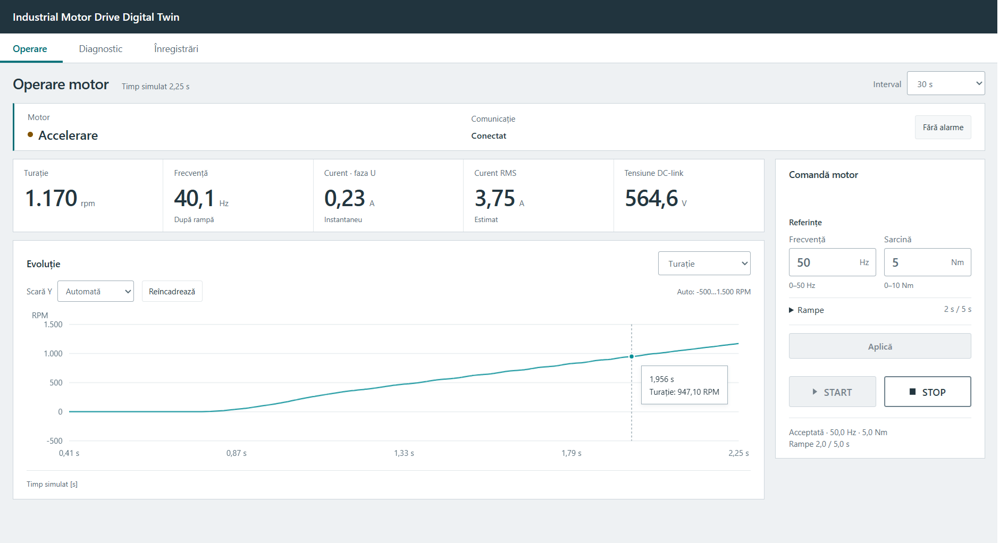
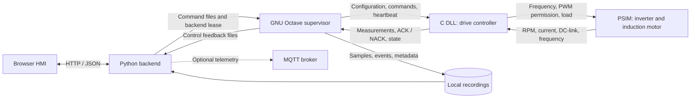
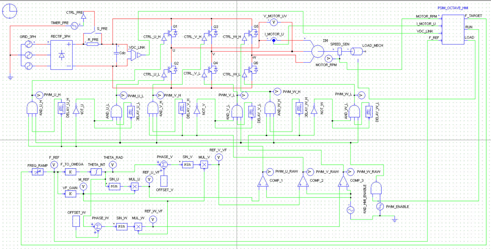
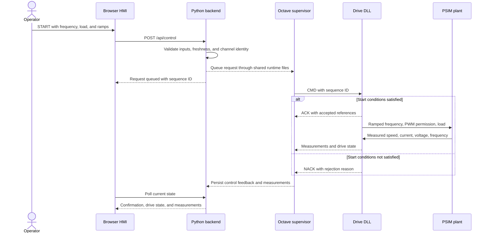
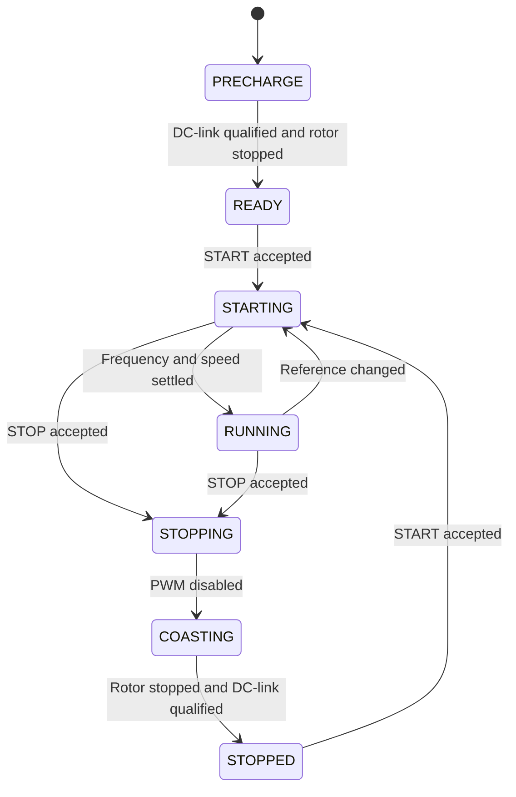
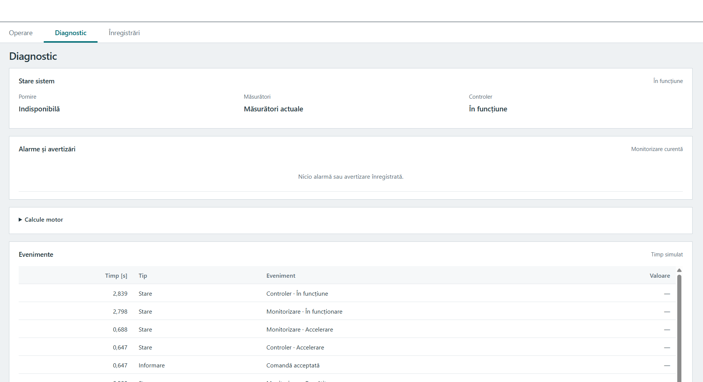
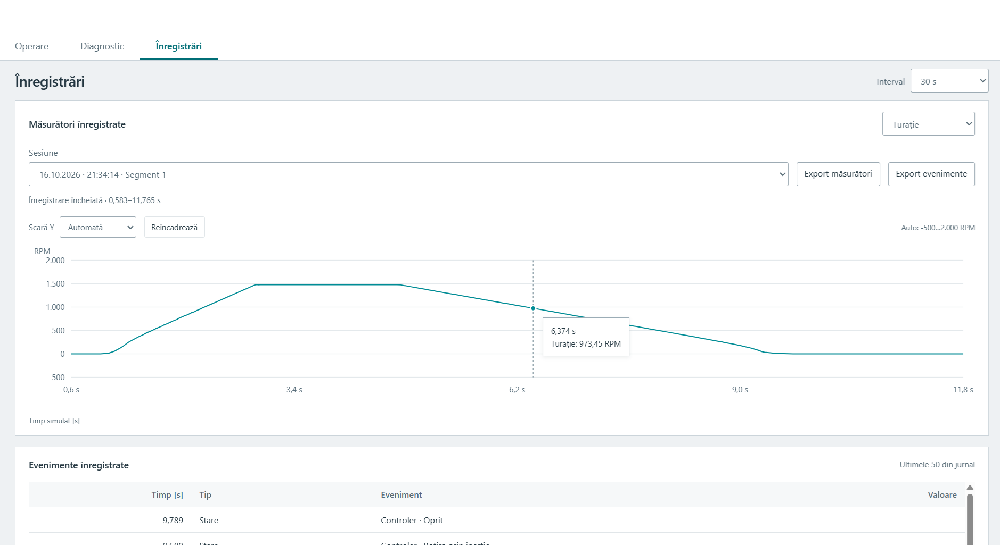

# Industrial Motor Drive Digital Twin

A local HMI for monitoring and controlling an induction motor drive simulated in PSIM. The application connects a native C drive controller to a browser interface through GNU Octave and a Python backend.

PSIM computes the electrical and mechanical response. The DLL controls drive sequencing, frequency ramps, PWM permission, and simulated protections. Octave processes measurements and records each run. The HMI provides operator commands, trends, diagnostics, and CSV export.

The current implementation targets **Windows and the PSIM x86 General DLL interface**. Operator labels are in Romanian. Physical motor integration and hardware PLC deployment are outside the current scope.



## Contents

- [Architecture](#architecture)
- [Requirements](#requirements)
- [Getting started](#getting-started)
- [PSIM circuit and wiring](#psim-circuit-and-wiring)
- [Motor control](#motor-control)
- [Monitoring and diagnostics](#monitoring-and-diagnostics)
- [Configuration](#configuration)
- [MATLAB compatibility](#matlab-compatibility)
- [Recordings and storage](#recordings-and-storage)
- [Verification](#verification)
- [Troubleshooting](#troubleshooting)
- [Repository layout](#repository-layout)

## Architecture



| Component | Responsibility |
| --- | --- |
| PSIM schematic | Supply, rectifier, DC-link precharge, PWM inverter, induction motor, and mechanical load |
| C DLL | Final command acceptance, drive state machine, ramps, PWM permission, and simulated protection trips |
| GNU Octave | TCP reception, command transport, measurement-derived diagnostics, and CSV/JSON persistence |
| Python backend | Process lifecycle, validated operator requests, current-state API, recording access, and MQTT publication |
| Browser HMI | Operator inputs, measured values, interactive trends, alarms, and recording export |

The running system takes its measurements from PSIM. The analytical motor calculations in `octave/src/` are separate utilities, not an independent dynamic motor simulation running behind the HMI. MQTT publishes telemetry only; it has no motor command path.

## Requirements

| Dependency | Purpose |
| --- | --- |
| Windows | Process management and native DLL execution |
| PSIM with a compatible x86 General DLL interface | Runs the schematic and loads the bridge |
| Python 3.10+ | Backend; the core application uses the standard library |
| GNU Octave with `instrument-control` | TCP supervisor and numerical processing |
| MSYS2 MinGW32 GCC | Builds the 32-bit DLL and native controller tests |
| Modern browser | HMI; no frontend build step or external fonts |
| Mosquitto and `paho-mqtt` | Optional MQTT output |
| Node.js 18+ | Frontend checks and tests; not required for operation |

The supplied [build script](bridge/build_hmi.bat) expects GCC at `C:\msys64\mingw32\bin\gcc.exe`. Update its paths if your installation differs. DLL architecture must match the PSIM host; this script produces an **x86 DLL**.

## Getting started

Run the PowerShell commands below from the repository root.

### 1. Configure Octave

Install the `instrument-control` package using Octave's package manager if needed, then confirm it loads:

```octave
pkg load instrument-control
```

The application searches `PATH` and common Windows installation locations for Octave. If discovery fails, set `octave.executabil` to its full executable path in [config/app_config.json](config/app_config.json).

### 2. Build and select the DLL

Stop the PSIM simulation before replacing a loaded DLL. Close PSIM if the library remains locked.

```powershell
.\bridge\build_hmi.bat
```

The output is `bridge/psim_drive_control_plc.dll`. Compiled DLLs are excluded from Git, so a fresh clone requires a local build.

Open `psim/smart_industrial_drive.psimsch`. In the `PSIM_OCTAVE_HMI` General DLL Block, select the **absolute path** to the built DLL. Verify the four inputs and three outputs using the wiring table below. A saved schematic may retain a path from another computer.

### 3. Start the application

```powershell
.\start.bat
```

The launcher starts the backend and Octave supervisor, then opens **[http://127.0.0.1:8765/](http://127.0.0.1:8765/)**. Keep the application terminal open while operating the system.

MQTT is enabled in the shared configuration but is optional. To use it, install Mosquitto and the Python dependency:

```powershell
py -3 -m pip install -r mqtt/requirements.txt
```

Set `mqtt.activ` to `false` if it is not needed. The HMI and motor control work without a broker. An existing broker is reused and is not stopped by the orchestrator.

### 4. Run PSIM and operate the motor

1. Start the simulation in PSIM with **F8**. Use Free Run or enough total time to operate the HMI.
2. Wait for current measurements and **Pregătit** (Ready).
3. Review frequency, load, and ramp settings, then press **START**.
4. Use **Aplică** (Apply) to send edited references. Editing an input alone does not change the running drive.
5. Press **STOP** for a normal ramped stop. Wait for the rotor to stop before restarting.

Initial form values are **50 Hz**, **5 Nm**, **2 s acceleration**, and **5 s deceleration**. The browser retains edited references locally, so review the displayed values on subsequent visits. Opening, refreshing, or reconnecting the HMI never sends START automatically.

### 5. Shut down

For a normal shutdown, stop the motor from the HMI, wait for it to stop, and stop the PSIM simulation. Then run:

```powershell
.\stop.bat
```

Ctrl+C in the application terminal also shuts down its owned services. PSIM is started and stopped separately. Closing the browser tab leaves the backend and Octave running and does not send a motor STOP command.

## PSIM circuit and wiring

The schematic implements a three-phase rectifier, DC-link precharge circuit, six-switch inverter, and induction motor with an externally controlled mechanical load. A V/f reference generator and PWM logic drive the inverter.



| Port | Signal | Connection / unit |
| --- | --- | --- |
| IN1 | `MOTOR_RPM` | Shaft speed feedback, rpm |
| IN2 | `I_MOTOR_U` | Phase U instantaneous current, A |
| IN3 | `VDC_LINK` | DC-link voltage, V |
| IN4 | `F_REF` | Output of `FREQ_RAMP`, Hz |
| OUT1 | `F_TARGET` | Input of `FREQ_RAMP`, Hz |
| OUT2 | `RUN` | One input of the two-input `AND_HMI_ENABLE`; the other receives `PWM_ENABLE` |
| OUT3 | `LOAD` | External torque input of `LOAD_MECH`, Nm |

`RUN` is the **PWM permission output**. It remains active during normal deceleration. The external `FREQ_RAMP` is a secondary rate limiter; its slopes and units must permit the requested HMI ramps, otherwise it can extend acceleration or stopping time.

The [DLL block port diagram](docs/assets/psim-dll-wiring.png) shows the measurement inputs and command outputs.

The bridge maintains static controller state and is intended for **one block instance in this schematic**. Its TCP destination is compiled as `127.0.0.1:5050`. Changing the Octave receiver port requires rebuilding the DLL with a matching `PORT_HMI` value.

## Motor control

### Command lifecycle



A successful HTTP request means the backend queued a command. An **ACK** means the DLL accepted it. PWM status and measured `F_REF`/`MOTOR_RPM` establish whether the plant responded. These are separate stages and are presented separately in the HMI.

### Normal operating cycle



The diagram shows the normal cycle. A protection trip overrides it, disables PWM, and latches **FAULT**. RESET requires the cause to clear, a stationary rotor, and qualified feedback; it does not restart the motor.

| Setting | Initial value | Accepted range |
| --- | --- | --- |
| Frequency | 50 Hz | 0–50 Hz; START requires a positive value |
| Load reference | 5 Nm | 0–10 Nm |
| Acceleration | 2 s | 1–30 s, referenced to 0–50 Hz |
| Deceleration | 5 s | 2–60 s, referenced to 50–0 Hz |

**START** requires a charged DC-link, a stopped rotor, a configured controller, fresh feedback, and no latched fault. **STOP** ramps frequency down with PWM enabled, then disables PWM and waits for the rotor to settle. STOP takes priority over a pending START. The mechanical load remains coupled during coasting and tapers below 50 rpm. Reverse rotation, flying start, and active braking are not implemented.

The DLL evaluates current, voltage, speed, feedback validity, stall, simplified thermal overload, communication loss, and sequence timeouts. Its default heartbeat watchdog is **2 seconds of wall-clock time**; ramps and dynamic protection timers use **simulation time**. Watchdog processing occurs within PSIM's DLL callbacks, so pausing the solver also pauses that processing.

See [Motor control](docs/control_hmi.md) for detailed thresholds, reset conditions, and protocol fields.

## Monitoring and diagnostics

| HMI page | Purpose |
| --- | --- |
| **Operare** — Operation | Drive state, communication, five measurements, interactive trend, references, START/STOP, and fault RESET |
| **Diagnostic** — Diagnostics | Start availability, controller feedback, active and cleared alarms, events, synchronous speed, and relative speed deviation |
| **Înregistrări** — Recordings | Session selection, recorded trends, closure status, events, sample inspection, and CSV export |

Measured channels are shaft speed, phase U current, DC-link voltage, and frequency after the ramp. Octave adds estimated RMS current, synchronous speed, and relative speed deviation. The load entered in the HMI is a **reference**, not measured shaft torque.

Charts use simulation time and preserve reported sampling gaps. The cursor follows samples using the mouse or keyboard: arrow keys move between samples, Home/End move to the ends, and Escape clears the cursor. Automatic scaling expands for new extremes; **Reîncadrează** (Reframe) fits the visible range again. Fixed chart ranges are display settings, not protection thresholds.

Protection RMS is calculated in the DLL from solver-step current samples over a 20 ms window. Displayed Octave RMS uses decimated TCP measurements and can be affected by PWM aliasing. Only phase U current is measured.



Stale measurements withdraw current readings and motor command availability. Historical data is marked as a recording. A browser-to-backend interruption does not itself stop the motor; backend/Octave or Octave/DLL loss is handled by the backend lease and DLL communication protection. MQTT loss does not stop the drive.

## Configuration

[config/app_config.json](config/app_config.json) contains the shared defaults. Restart the application after changes. The existing Romanian configuration and API field names are part of the current data contract.

| Configuration field | Default | Meaning |
| --- | --- | --- |
| `port_web` | `8765` | Local HMI/API port |
| `octave.executabil` | Empty | Explicit executable path, or automatic discovery |
| `psim.port_tcp` | `5050` | Receiver port; must match the DLL build |
| `psim.segment_s` | `60` | Recording segment length, simulation seconds |
| `fereastra_s` | `30` | Initial chart window, simulation seconds |
| `puncte_maxime` | `1000` | Chart aggregation point budget |
| `date_vechi_s` | `3` | Measurement freshness timeout, wall-clock seconds |
| `control` | See file | Command limits, ramps, expiry, watchdog, and backend lease |
| `protection` | See file | DLL protection and DC-link readiness settings |
| `diagnostic` | See file | Informational Octave thresholds, hysteresis, and windows |
| `recording.max_storage_mb` | `512` | Rolling recording quota, MiB |
| `retentie_zile` | `0` | Age-based retention; zero disables age-based deletion |
| `mqtt` | Enabled; port `1883` | Optional broker connection and telemetry output |

For local changes, copy the **complete** configuration to an ignored file such as `config/app.local.json`, then launch:

```powershell
py -3 orchestrator.py --config config/app.local.json --fara-browser
```

This is a complete configuration, not a partial merge. Results must remain in a subdirectory of the project. The HTTP service binds to `127.0.0.1`; the application is intended for local operation and has no remote multiuser deployment model.

The reference ratings **4 kW, 400 V, 8.2 A, 1430 rpm, four poles, and 2 kHz PWM** need confirmation against the complete PSIM component configuration. Protection limits and V/f scaling must be validated against that circuit. The implemented protections are simulated functions, not hardware safety functions or a guarantee of damage prevention.

### Optional MQTT output

With the default prefix `industrial-drive/v2`:

| Topic suffix | Payload |
| --- | --- |
| `psim/telemetrie` | Current PSIM-derived telemetry |
| `stare` | Publisher and acquisition state |
| `alarme` | Informational alarm conditions |

Credentials can be supplied through `IDRIVE_MQTT_USER` and `IDRIVE_MQTT_PASSWORD`. Keep credentials out of the shared configuration and repository.

## MATLAB compatibility

The analytical motor model in `octave/src/`, its baseline entry point in `octave/scripts/run_baseline.m`, and the corresponding motor-model test use MATLAB-compatible `.m` syntax and are intended to run in both MATLAB and GNU Octave. PSIM remains the source of simulated electrical and mechanical behavior; these scripts perform separate calculations.

The live PSIM supervisor and data path require GNU Octave. They use Octave-specific syntax and the `instrument-control` package for TCP communication, so the full application is **not currently compatible with MATLAB as-is**. MATLAB is not installed in the verification environment, so MATLAB execution has not been independently tested.

## Recordings and storage

Each segment under `results/` contains:

```text
psim_<timestamp>_<session>_partNNNN_samples.csv
psim_<timestamp>_<session>_partNNNN_events.csv
psim_<timestamp>_<session>_partNNNN_meta.json
```

Samples contain measured and calculated values; events contain transitions and diagnostic/control events. Metadata identifies the run, units, freshness, and whether recording closure was confirmed.

The backend keeps bounded recording windows and aggregates chart points. CSV export returns the recorded file, not the reduced chart data. The rolling quota removes eligible older finalized segments while protecting the active segment and the two newest segments. It is a retention target rather than a hard filesystem cap.



Application retention does not limit PSIM's `.smv` files or solver memory. Configure PSIM's print interval separately for long Free Run sessions. At a 1 µs solver step, print step 1000 records one point per millisecond per signal; this reduces output volume but cannot resolve a 2 kHz switching waveform. Use shorter, higher-resolution runs to inspect PWM behavior.

Runtime state, recordings, logs, caches, and compiled binaries are excluded by [.gitignore](.gitignore). The schematic, source, shared configuration, tests, and documentation belong in Git.

## Verification

### Compare with PSIM

1. At the same **simulation timestamp**, compare `MOTOR_RPM`, `I_MOTOR_U`, `VDC_LINK`, and `F_REF` in Simview, the HMI, and the exported samples CSV.
2. After START, follow: accepted references → `F_TARGET` → `F_REF` → PWM/current → shaft speed.
3. After STOP, verify the frequency ramp, PWM disable, coasting, and stopped-state qualification.
4. Confirm that faults latch until an eligible RESET and reconnecting does not restart the drive.

See [PSIM data verification](docs/psim_data_verification.md) for the detailed procedure and [PLC-HMI audit](docs/plc_hmi_audit.md) for assumptions and outstanding validation. Isolated tests verify software behavior; they do not establish the electrical accuracy of the native schematic.

### Automated checks

From the repository root:

```powershell
py -3 -m unittest discover -s tests -v
node --check dashboard/app.js
node --check dashboard/charts.js
node --test tests/test_hmi_ui.js tests/test_hmi_charts.js
```

The Python suite compiles native controller tests and requires MinGW32 GCC at the path specified in `tests/test_drive_controller.py`. For Octave checks, run from `octave/`:

```octave
addpath('tests');
test_psim_diagnostics();
test_motor_model;
```

Stop the normal application before integration checks, and run them **sequentially**. They allocate isolated ports and temporary recordings, but the orchestrator permits one instance per project:

```powershell
py -3 -m tests.test_system_integration
py -3 -m tests.test_control_integration
```

System integration requires Octave, Mosquitto, and Paho. Control integration requires Octave and MinGW32 GCC and exercises the DLL in an isolated x86 host. Generated test signals are confined to these checks.

## Troubleshooting

| Symptom | Check |
| --- | --- |
| **Conexiune întreruptă** in the HMI | Keep the application terminal open. Check `http://127.0.0.1:8765/api/stare`. If it responds, inspect browser console errors. After frontend updates, use Ctrl+F5. |
| Backend works; no measurements | Confirm PSIM is advancing, the DLL path and architecture are correct, and one Octave receiver owns port 5050. |
| START unavailable | Check Diagnostics for stale feedback, precharge, a moving rotor, a stopping sequence, a latched fault, or missing DLL configuration. |
| DC-link present; zero current and speed | Check START acceptance, `F_TARGET`, `F_REF`, `RUN`, and PWM gating. DC-link voltage alone does not run the motor. |
| Simulation ends before START | Increase total time or use Free Run in PSIM. |
| DLL cannot be replaced | Stop the simulation and close PSIM to release the loaded library. |
| MQTT disconnected | Check Mosquitto and Paho, or disable optional MQTT. Motor control does not depend on the broker. |
| Disk usage grows in Free Run | Inspect both application recordings and PSIM output; CSV retention does not manage `.smv` files. |

## Repository layout

```text
application/             Configuration, control requests, data access, process management
bridge/                  C controller, PSIM TCP bridge, x86 build script
config/                  Shared application configuration
dashboard/               HTML/CSS/JavaScript HMI and local HTTP server
docs/                    Control, verification, and design notes
  assets/                HMI screenshots and PSIM schematics used below
octave/                  GNU Octave supervisor, diagnostics, and persistence
  src/                   Separate analytical motor calculations
  scripts/               Explicit baseline calculation entry point
  tests/                 Numerical and diagnostic checks
mqtt/                    Optional telemetry publisher and dependency specification
psim/                    Native PSIM schematic
results/                 Local generated data; ignored except for .gitkeep
tests/                   Backend, frontend, controller, and integration checks
orchestrator.py          Application lifecycle entry point
start.bat / stop.bat     Windows launch and shutdown commands
```

## License, Copyright & Confidentiality Terms

**Copyright © 2026 Ioan-Mădălin Munteanu. All rights reserved.**

This project is strictly **proprietary and confidential**. The source code, software architecture, DB schemes, SCL routines, and graphical HMI layout assets are published publicly on GitHub **SORELY for portfolio evaluation, academic auditing, and technical interview demonstration purposes** by prospective employers and technical recruiters.

**Under no circumstances is any user, corporation, or entity permitted to:**
1. Download, clone, copy, or duplicate this code for implementation inside real-world commercial production lines or industrial manufacturing plants.
2. Modify, transform, or build derivative industrial automation solutions based on the logic designs contained within this repository.
3. Redistribute, re-license, publish, or sell these engineering files to third parties.

*The engineering files are provided purely "as-is" for interview presentation metrics, without any structural warranties regarding real-world hardware deployment safety.*

Additional guides: [Drive control](docs/control_hmi.md) · [Data verification](docs/psim_data_verification.md) · [HMI design](docs/hmi_design.md) · [Control audit](docs/plc_hmi_audit.md) · [Octave module](octave/README.md).
