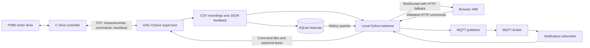

# Monitoring and history

The monitoring layer publishes measurements and events from the existing motor data path. PSIM supplies the electrical and mechanical response; the C DLL controls the drive; Octave receives measurements, calculates diagnostics, and records each run.

## Data flow



Motor commands use the existing HTTP, runtime-file, and TCP path. SQLite, WebSocket, and MQTT do not participate in command acceptance or protection decisions. Their failure leaves the controller's interlocks and communication watchdog in effect.

| Module | Responsibility |
| --- | --- |
| `application/historian.py` | Background indexing, retention, and read-only history queries |
| `application/telemetry.py` | Current snapshots and bounded, ordered event journal |
| `dashboard/stream.py` | WebSocket upgrade on the existing local HTTP server |
| `dashboard/transport.js` | Browser reconnection and HTTP fallback |
| `dashboard/iiot.js` | Communication status, notification acknowledgement, and history queries |
| `mqtt/publisher.py` | Telemetry, acquisition status, alarms, and event publication |
| `mqtt/consumer.py` | Notification validation, deduplication, and broker status |
| `mqtt/contracts.py` | Shared topics, client bounds, and TLS configuration |

## Configuration

Install the transport dependencies from the repository root:

```powershell
py -3 -m pip install -r requirements.txt
```

SQLite uses Python's standard library. Without the WebSocket library, the HMI uses HTTP polling. MQTT is optional and can be disabled with `mqtt.activ: false`.

The `iiot` section of [app_config.json](../config/app_config.json) contains three settings groups:

| Group | Defaults |
| --- | --- |
| `historian` | Enabled; sample interval 0.05 simulation seconds; 30-day retention; 200,000 samples; 50,000 events; 128 MiB capacity |
| `websocket` | Enabled; 0.75-second update interval; 8 clients; 512-event journal; 3-second send timeout |
| `notifications` | Enabled with MQTT; 200 notifications |

Use a complete ignored `config/app.local.json` for local overrides. Restart the application after editing configuration. Numeric limits and unknown settings are validated at startup.

## Motor history

The writer indexes existing recording segments in a background thread. It stores samples at the configured simulation-time interval and on state changes, and indexes recorded events independently of sample decimation. CSV remains the detailed recording and export format.

The database at `results/historian.sqlite3` uses WAL mode. Its tables are:

- `sessions`: recording segment identity, run identity, source, and units.
- `samples`: simulation time, ingestion time, measured and calculated channels, and drive state.
- `events`: stable event ID, session, source, code, severity, value, and timestamps.
- `cursors`: committed file offsets used to resume indexing after restart.

Simulation time describes the motor run. `observed_epoch` records when the backend indexed or observed data; it does not establish when an older sample was simulated. Select the same simulation timestamp when comparing the HMI with Simview.

Retention limits apply independently of the CSV quota. Age-based cleanup uses ingestion time, and row limits are enforced in batches. The SQLite page capacity, WAL, and cleanup behavior provide bounded storage rather than an exact filesystem quota. Database errors are reported in Diagnostics while CSV access and motor control remain available.

### Query API

| Endpoint | Parameters / result |
| --- | --- |
| `GET /api/historian/sessions` | Indexed motor segments and time bounds |
| `GET /api/historian/query` | `session`, `start`, `end`, `axis`, `limit`, `after`; samples, interval statistics, and session events |
| `GET /api/historian/events` | `source`, `start`, `end`, `after`, `limit`; events ordered by sequence |

Sample queries default to simulation time; `axis=observed` selects ingestion time. Event queries use observation time. Pagination returns `next_after` when more rows remain. Sample pages are limited to 1,000 rows and event pages to 500 rows. A session query includes up to 100 events and reports `events_limited` when that cap is reached.

In **Înregistrări**, select a session and simulation interval to inspect minimum, maximum, and average values. An optional second session provides a comparison over the same interval. These statistics describe indexed samples; use CSV for detailed waveform analysis.

## HMI transport

WebSocket shares the existing loopback HTTP port and accepts only the local HMI origin. The stream carries snapshots and ordered events, and accepts no motor commands. Slow clients receive current snapshots rather than accumulating obsolete ones; event-journal overflow requires resynchronization. Connection count, frame size, queues, and send duration are bounded.

The browser falls back to HTTP when streaming is unavailable and retries with backoff. Reconnection does not issue START or replay operator commands. Stale measurements remain unavailable for control regardless of transport.

## MQTT monitoring

The default prefix is `industrial-drive/v2`.

| Topic suffix | QoS | Retained | Content |
| --- | --- | --- | --- |
| `psim/telemetrie` | 0 | No | Current PSIM-derived measurements and units |
| `stare` | 1 | Yes | Publisher and acquisition state; Last Will reports disconnection |
| `alarme` | 1 | No | Informational alarm conditions |
| `events` | 1 | No | Motor and communication events |

Event messages use `schema: industrial-drive.event.v1` and carry a stable `id`, `source`, `code`, `severity`, and `observed_epoch`. Motor events also carry simulation time and session identity when available. The subscriber rejects malformed, oversized, expired, and retained event messages; repeated IDs do not produce duplicate notifications.

Broker reconnection restores subscriptions automatically. A bounded event journal reports gaps instead of implying complete delivery. MQTT notification acknowledgement records operator awareness in the current application instance; it does not clear a controller fault or issue RESET. Recorded motor and communication events remain available in history.

For a remote broker, configure TLS and supply credentials through `IDRIVE_MQTT_USER`, `IDRIVE_MQTT_PASSWORD`, and optionally `IDRIVE_MQTT_CA_FILE`. Restrict observers to read-only topic access. The local HMI and command API remain bound to loopback.

## Verification

From the repository root:

```powershell
py -3 -m unittest discover -s tests -v
node --check dashboard/iiot.js
node --check dashboard/transport.js
node --test tests/test_hmi_ui.js tests/test_hmi_charts.js tests/test_hmi_transport.js
```

The Python suite covers restartable indexing, deduplication, retention, history queries, actual local WebSocket connections, and MQTT broker restart and resubscription. MQTT integration requires Mosquitto and Paho; tests report a skip when a required optional dependency is unavailable.

Stop the normal application and run the full-system checks sequentially:

```powershell
py -3 -m tests.test_system_integration
py -3 -m tests.test_control_integration
```

These checks use isolated inputs and temporary recordings. They verify the software transport and control path; verify the native electrical circuit separately using [PSIM data verification](psim_data_verification.md).
